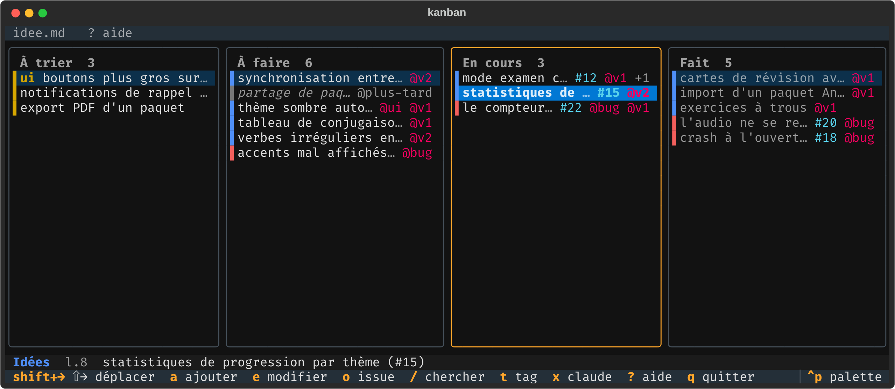

# kanban-terminal

Un fichier Markdown d'idées affiché en **tableau Kanban interactif dans le terminal**, assez compact pour le panneau du bas de VS Code.

Le fichier reste la source : chaque action modifie la ligne de la carte (et rien d'autre), et le tableau se recharge tout seul quand le fichier change, par exemple quand tu l'édites dans VS Code en même temps.



## Installation

Il faut Python 3.10 ou plus.

```sh
git clone https://github.com/antoine123456/kanban-terminal.git
pipx install -e kanban-terminal          # la commande « kanban » partout
# ou, sans pipx :
cd kanban-terminal && python3 -m venv .venv && .venv/bin/pip install -e .
```

Pour les issues GitHub (touches **o i c g**), installer aussi [`gh`](https://cli.github.com) et lancer `gh auth login` une fois.

## Utilisation

```sh
kanban                 # cherche idee.md, ideas.md, TODO.md… dans le dossier courant
kanban chemin/idees.md
kanban --repo propriétaire/nom   # si le dépôt GitHub n'est pas celui du git du fichier
kanban --theme light             # ou dark ; auto par défaut (aussi : KANBAN_THEME=light)
```

**Clair ou sombre** : comme le terminal autour. Au démarrage, le tableau demande au terminal sa couleur de fond ; sinon il lit le thème de VS Code (`workbench.colorTheme`, ou le thème jour / nuit si `window.autoDetectColorScheme` est activé), sinon l'apparence du système. Il suit ensuite les changements (VS Code ou macOS qui passent en mode nuit) toutes les 3 s. **T** bascule à la main.

Dans VS Code, ouvre un terminal dans le panneau du bas (⌃`), lance `kanban`, puis déplace le terminal où tu veux (clic droit sur l'onglet → « Déplacer dans la zone d'éditeur » pour l'avoir à côté du code).

### Touches

| | |
|---|---|
| ← → ↑ ↓ (ou h j k l), clic | se déplacer ; **Entrée** : détail de la carte (notes, issues) |
| **⇧← ⇧→** (ou `<` `>`), **1 2 3 4** | déplacer la carte : À trier / À faire / En cours / Fait |
| **a** | ajouter une idée dans « À trier » |
| **e** / **E** | modifier le texte / ouvrir le fichier à la ligne dans VS Code (`code -g`) ou `$EDITOR` |
| **o** · **i** · **c** · **g** | GitHub : ouvrir l'issue · créer l'issue de la carte (milestone d'après son tag) · fermer / rouvrir · actualiser |
| **/** · **t** · **s** · **f** · **w** | chercher · filtrer par tag (@v1…) · par section · cacher « Fait » · texte complet sur plusieurs lignes |
| **x** · **X** | Claude Code : traiter la carte choisie · traiter toute la boîte « À trier » (voir plus bas) |
| **Échap** · **r** · **T** · **?** · **q** | effacer les filtres · recharger · clair / sombre · aide · quitter |

En sortant une carte de « À trier », le tableau demande dans quelle section la ranger (Idées, Correction…). Une carte passée dans « Fait » qui a une issue encore ouverte propose de la fermer sur GitHub.

### Lancer Claude depuis le tableau

**x** lance [Claude Code](https://claude.com/claude-code) sur la carte choisie : le tableau s'efface, `claude` s'ouvre dans le même terminal, dans le dossier du fichier, avec le texte de la carte (et ses notes) comme première demande. **X** lui demande de traiter toute la boîte « À trier » (« exécute Pending »). Quand tu quittes Claude (`/exit` ou ⌃D deux fois), le tableau revient, rechargé avec ce que Claude a changé dans le fichier. Autre commande : `KANBAN_CLAUDE="claude --model opus" kanban`.

### Vue Gantt (G)

**G** passe du tableau au Gantt du même fichier (par agent, puis par tâche, puis retour au tableau). Aussi en ligne de commande : `gantt fichier.md` (`--by task`, `--play` rejoue le plan, `--watch` reste ouvert et suit le fichier).

Une carte apparaît sur le Gantt si elle a une note `gantt: début-fin` (en créneaux). Son tag `@volet1`… donne la couleur, son tag d'agent donne la ligne. Dans la section Règles :

```markdown
- agents: lead, scan, you          l'ordre des lignes (you = tes relectures, ◆)
- unit: 5 min                      la durée d'un créneau
- start: 2026-11-18 15:00          optionnel : le début réel du travail
```

La **ligne rouge** montre où on en est. Avec `start:`, c'est l'heure actuelle, et l'en-tête dit si le plan a de l'avance ou du retard : le plan est « fait » jusqu'à la première carte pas finie. Sans `start:`, la ligne marque ce point d'avancement. Elle se met à jour toute seule quand tu coches des cartes.

## Format du fichier

```markdown
## Idées                          une section = une catégorie de cartes
- [ ] à faire                     [ ] À faire · [_] En cours · [x] ou [X] Fait
- [_] à moitié fait (#12) @v1     #12 = issue GitHub · @v1 = tag (le milestone de l'issue)
- [ ] mise de côté @v1 @plus-tard @plus-tard l'emporte : carte grisée, hors du filtre @v1
  - une note                      les lignes indentées sont les notes de la carte
conjugaison:                      une ligne finie par « : » = groupe des cartes qui suivent
## Correction
- [X] corrigé (#20) @v1
## Pending                        la boîte de réception (Pending, Inbox, À trier) : chaque « - » est une carte
- [ui] une idée à classer         une marque inconnue devient un tag ([ui] → @ui une fois rangée)
- une autre
```

Une section « Règles » (ou « Rules ») est ignorée.

Les issues GitHub passent par la commande `gh`, si elle est installée et connectée. Sans elle, le tableau marche quand même et affiche juste les numéros.

## Tests

```sh
.venv/bin/python -m unittest discover -s tests
```
