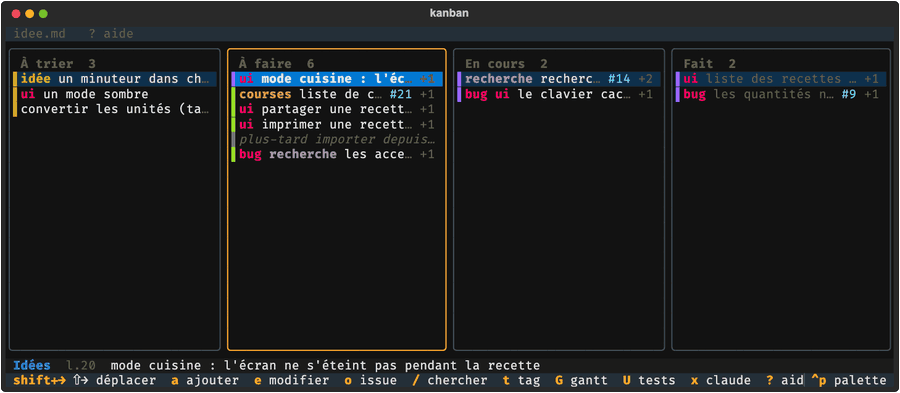

# kanban-terminal

**[Essayer en ligne →](https://antoine123456.github.io/kanban-terminal/)** — le tableau dans le navigateur, sans rien installer : mêmes touches, et le fichier Markdown à côté.

Un fichier Markdown d'idées affiché en **tableau Kanban interactif dans le terminal**, assez compact pour le panneau du bas de VS Code.

Le fichier reste la source : chaque action modifie la ligne de la carte (et rien d'autre), et le tableau se recharge tout seul quand le fichier change, par exemple quand tu l'édites dans VS Code en même temps.



## Installation

Il faut Python 3.10 ou plus.

```sh
git clone https://github.com/antoine123456/kanban-terminal.git
pipx install -e kanban-terminal          # les commandes kanban, gantt, tests, kanban-snippets et kanban-tidy partout
# ou, sans pipx :
cd kanban-terminal && python3 -m venv .venv && .venv/bin/pip install -e .
```

Pour les issues GitHub (touches **o i c g**), installer aussi [`gh`](https://cli.github.com) et lancer `gh auth login` une fois.

## Utilisation

```sh
kanban                 # cherche idee.md, ideas.md, TODO.md… dans le dossier courant
kanban chemin/idees.md
kanban --repo propriétaire/nom   # si le dépôt GitHub n'est pas celui du git du fichier
kanban --theme light             # ou dark ; auto par défaut (aussi : KANBAN_THEME=light)
```

**Clair ou sombre** : comme le terminal autour. Au démarrage, le tableau demande au terminal sa couleur de fond ; sinon il lit le thème de VS Code (`workbench.colorTheme`, ou le thème jour / nuit si `window.autoDetectColorScheme` est activé), sinon l'apparence du système. Il suit ensuite les changements (VS Code ou macOS qui passent en mode nuit) toutes les 3 s. **T** bascule à la main.

Dans VS Code, ouvre un terminal dans le panneau du bas (⌃`), lance `kanban`, puis déplace le terminal où tu veux (clic droit sur l'onglet → « Déplacer dans la zone d'éditeur » pour l'avoir à côté du code).

### Touches

| | |
|---|---|
| ← → ↑ ↓ (ou h j k l), clic | se déplacer ; **Entrée** : détail de la carte (notes, issues) |
| **⇧← ⇧→** (ou `<` `>`), **1 2 3 4** | déplacer la carte : À trier / À faire / En cours / Fait |
| **a** | ajouter une idée dans « À trier » |
| **e** / **E** | modifier le texte / ouvrir le fichier à la ligne dans VS Code (`code -g`) ou `$EDITOR` |
| **o** · **i** · **c** · **g** | GitHub : ouvrir l'issue · créer l'issue de la carte (milestone d'après son tag) · fermer / rouvrir · actualiser |
| **/** · **t** · **s** · **f** · **w** | chercher · filtrer par tag (@v1…) · par section · cacher « Fait » · texte complet sur plusieurs lignes |
| **x** · **X** | Claude Code : traiter la carte choisie · traiter toute la boîte « À trier » (voir plus bas) |
| **Échap** · **r** · **T** · **?** · **q** | effacer les filtres · recharger · clair / sombre · aide · quitter |

En sortant une carte de « À trier », le tableau demande dans quelle section la ranger (Idées, Correction…). Une carte passée dans « Fait » qui a une issue encore ouverte propose de la fermer sur GitHub. La colonne « Fait » montre en haut les tâches faites le plus récemment : par numéro d'issue (#N), une carte sans issue prenant celui de la carte au-dessus d'elle dans le fichier.

### Lancer Claude depuis le tableau

**x** lance [Claude Code](https://claude.com/claude-code) sur la carte choisie : le tableau s'efface, `claude` s'ouvre dans le même terminal, dans le dossier du fichier, avec le texte de la carte (et ses notes) comme première demande. **X** lui demande de traiter toute la boîte « À trier » (« exécute Pending »). Quand tu quittes Claude (`/exit` ou ⌃D deux fois), le tableau revient, rechargé avec ce que Claude a changé dans le fichier. Autre commande : `KANBAN_CLAUDE="claude --model opus" kanban`.

### Vue Gantt (G)

**G** passe du tableau au Gantt du même fichier (par agent, puis par tâche, puis retour au tableau). Aussi en ligne de commande : `gantt fichier.md` (`--by task`, `--play` rejoue le plan, `--watch` reste ouvert et suit le fichier). Dans la vue, **↑↓** (ou **j k**) ou **un clic** éclairent une ligne d'un bout à l'autre, pour la suivre de son nom jusqu'à ses barres ; un clic sur la ligne éclairée l'éteint. Avec une horloge (`start:`), l'en-tête donne aussi la **fin prévue au rythme réel** : ce qui reste du plan, étiré comme ce qui est fait (« end ≈ 11:17 at this pace (×0.28) » = presque quatre fois plus vite que prévu).

Une carte apparaît sur le Gantt si elle a une note `gantt: début-fin` (en créneaux). Son tag `@volet1`… donne la couleur, son tag d'agent donne la ligne. Dans la section Règles :

```markdown
- agents: lead, scan, you          l'ordre des lignes (you = tes relectures, ◆)
- unit: 5 min                      la durée d'un créneau
- start: 2026-11-18 15:00          optionnel : le début réel du travail
```

Les barres n'ont pas de texte : trois teintes de la couleur de la phase, █ fait, ▒ en cours, ░ à faire.

La **ligne rouge ┃** montre l'avancement, et seuls des **marqueurs** la font bouger : une carte cochée `[_]` ou `[X]`, ou une note `at: 60%` sous une carte en cours (la barre se remplit jusque-là). Elle se place sur la première carte pas finie, à son début ou à son marqueur : tout ce qui est à gauche est fait. Avec `start:` dans Règles, une ligne grise **┊** montre l'horloge, et l'en-tête dit l'avance ou le retard.

### Vue Tests (U)

**U** affiche les tests du projet comme l'ancien lanceur JUnit : une barre **verte** si tout passe, **rouge** dès qu'un test échoue, puis `Runs · Errors · Failures · Skipped`. En dessous, les échecs d'abord, puis les autres en gris. Les tests ne se lancent pas tout seuls : **r** les lance (et les relance). ↑↓ sur un test montre sa trace. En ligne de commande : `tests [dossier]`, qui renvoie le code 1 si c'est rouge.

Les résultats sont lus dans des rapports **JUnit XML**, le format que savent écrire tous les outils de test. Le projet est trouvé en remontant à la racine git, puis :

| Projet | Commande lancée |
|---|---|
| `pom.xml` | `mvn test` → `target/surefire-reports/` |
| `build.gradle(.kts)` | `gradle test` → `build/test-results/test/` |
| Python avec pytest | `pytest --junitxml` |
| Python avec `tests/` | unittest, via `unittest_xml.py` (unittest n'écrit pas de JUnit XML) |
| autre (Jest, cargo…) | `tests --cmd "…" --report "chemin/*.xml"` |

Python : le `.venv` du projet est utilisé s'il existe.

## Format du fichier

```markdown
## Idées                          une section = une catégorie de cartes
- [ ] à faire                     [ ] À faire · [_] En cours · [x] ou [X] Fait
- [_] à moitié fait (#12) @v1     #12 = issue GitHub · @v1 = tag (le milestone de l'issue)
- [ ] mise de côté @v1 @plus-tard @plus-tard l'emporte : carte grisée, hors du filtre @v1
  - une note                      les lignes indentées sont les notes de la carte
conjugaison:                      une ligne finie par « : » = groupe des cartes qui suivent
## Correction
- [X] corrigé (#20) @v1
## Pending                        la boîte de réception (Pending, Inbox, À trier) : chaque « - » est une carte
- [ui] une idée à classer         une marque inconnue devient un tag ([ui] → @ui une fois rangée)
- une autre
```

Une section « Règles » (ou « Rules ») n'a pas de cartes. Elle peut décrire les tags, une ligne par tag :

```markdown
## Règles
- @idée: une idée pas encore planifiée
- @volet1: préparer
```

**Couleurs des tags** : un jalon (`@v1`, `@volet2`…) colore la barre à gauche de la carte, avec la même couleur que sa phase dans le Gantt. Les autres tags s'écrivent avant le texte, en gras et en couleur (toujours la même pour un tag) : `[idée]` dans la boîte « À trier » et `@idée` une fois la carte rangée s'affichent pareil. Le menu **t** et le détail (**Entrée**) montrent la description de chaque tag. Un jalon sans description prend le nom de la section où sont ses cartes.

**Les tags proposés en tapant, dans VS Code** : `kanban-snippets` lit les tags et leurs descriptions (lignes `- @tag: …` des Règles, ou tableau `| @tag | description |` sous une section « ## Tags ») et écrit `.vscode/markdown.code-snippets` à côté du fichier. Taper `@v` dans un fichier Markdown propose alors `@v1` avec sa description. La commande signale aussi les tags utilisés sans description.

```sh
kanban-snippets                # idee.md, ideas.md, TODO.md… du dossier courant
kanban-snippets chemin/idees.md
```

Pour la lancer depuis VS Code (F1 → « Tasks: Run Task »), et à chaque ouverture du dossier, ajoute une tâche dans `.vscode/tasks.json` :

```json
{ "version": "2.0.0", "tasks": [
  { "label": "Tags → snippets", "type": "shell", "command": "kanban-snippets",
    "problemMatcher": [], "runOptions": { "runOn": "folderOpen" } } ] }
```

Les suggestions apparaissent en tapant si `"[markdown]": { "editor.quickSuggestions": { "other": "on" } }` est dans les réglages.

**Ranger le fichier à chaque enregistrement** : `kanban-tidy` range le fichier d'idées, sans IA :

- **Pending numéroté** : chaque point devient une carte du tableau (`- `) et reçoit un numéro dans l'ordre du fichier, `- P1 @tag …`, `- P2 …` (P plutôt que #, qui désigne une issue). Un point commence par `- `, ou par `@…` après une ligne vide ; le reste (un log collé, une réponse `→ …`) reste dans le point du dessus.
- **Tags manquants** : un tag utilisé dans le Pending mais décrit nulle part reçoit une ligne `| @tag | à décrire |` dans le tableau « ## Tags ».
- **Snippets** : `.vscode/markdown.code-snippets` est réécrit (comme `kanban-snippets`).

Le fichier n'est réécrit que si quelque chose change, et pas s'il a été réenregistré entre-temps.

```sh
kanban-tidy                    # une fois
kanban-tidy idee.md --watch    # à chaque enregistrement
```

Dans VS Code, une tâche de fond le lance à l'ouverture du dossier, puis il range à chaque enregistrement :

```json
{ "label": "idee.md → rangé à chaque enregistrement", "type": "shell",
  "command": "kanban-tidy idee.md --watch", "isBackground": true, "problemMatcher": [],
  "presentation": { "reveal": "never", "panel": "dedicated" }, "runOptions": { "runOn": "folderOpen" } }
```

Les issues GitHub passent par la commande `gh`, si elle est installée et connectée. Sans elle, le tableau marche quand même et affiche juste les numéros.

## Tests

```sh
.venv/bin/python -m unittest discover -s tests
```
